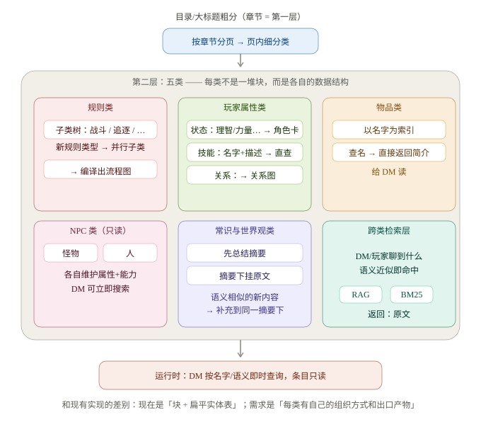

# 交接文档：剧本切分与知识库结构设计（含全部已定决策与实证）

> 时间：2026-10-24 凌晨 02:00 ｜ 前任：Claude（WorkBuddy Agent）｜ 项目：RPGBar 编译器（compiler/）
> 本文覆盖从「用户原始需求全貌」到「第 0 步改造定案」的全部推理链，供接手者直接续做，不需要重读对话。

---

## 1. 用户的原始需求（这是唯一宪法，其余一切从它推出）

用户原话要点（2026-10-24 凌晨给出）：

> 首先遍历剧本，观察是否有目录和大标题，如果有的话，先粗分，按章节分页。之后在每页中再遍历，将内容分为五类：**规则类、玩家属性类、工具类、NPC类、常识与世界观类**。
> 1. 规则类中，当被认为是"战斗"相关内容介绍时再细分为一个规则下的子类，随后每当出现一个新的类似规则的类就添加为一个并行的子类。最后根据规则做出流程图。
> 2. 玩家属性类中：子类**状态**（理智、力量等属性 → 最终生成角色卡）；**技能**（技能名+描述，玩家声明使用时可直接查到）；**角色关系**（关系图）。
> 3. 物品类以**名字为索引**，需要某物品时直接通过名字找到简介，返回给 DM 读取。
> 4. NPC 类分为**怪物和人**，两类各自维护属性与能力，**只读**，DM 能立刻搜索到。
> 5. 常识与世界观类：先**总结摘要**再存**原文**；语义相似的新内容，原文补充挂在当前摘要下面。
>
> 以上所有内容，当 DM 与玩家交流到语义近似的内容时，应当能通过 **RAG + BM25** 检索到原文。假定以中文文本为主。

**关键解读：用户需求里藏着一层数据结构**——五分类不是五种标签，而是**五个各有子结构与出口产物的容器**。用户已确认下图完全正确（此图为用户钦定的需求表达原版，接手者以它为准）：



用户确认：**item 和属性是"子集"关系**（挂在对应类之下，不是平行类）。

## 2. 用户已拍板的设计决策（逐条确认过，不要重开讨论）

| # | 议题 | 定案 |
|---|------|------|
| 1 | 判别权 | **LLM 唯一主判**。规则打分层退役为"词典服务"（只给 prompt 提供类别定义）。失败重试 1 次，仍败 → unclassified + 争议池，**绝不让词表猜** |
| 2 | 规则子类树 | LLM 编译期**聚类+命名，标签从书里长出来**，零预设词表（用户接受模型命名，事后可改名） |
| 3 | 角色卡 schema | **从书中学出字段**，不用固定 CoC 模板 |
| 4 | 关系图 | 编译期只收**明示关系句**做种子边；运行期玩家-NPC 互动会增长/改变图谱（动态边是运行时的事） |
| 5 | 怪物/人边界 | 以**「是否被明确定义为可战斗对象」**为准 |
| 6 | 章节粗分 | **软信号，非硬边界阶段**。标题层级捕获进 prompt 帮助分类即可，直接遍历+结构切分（用户实测观察：差距不大） |
| 7 | 总原则 | **一切从书里学，零硬编码**（为了通用所有模组）；开销可接受——一本书只编译一次，用户原话"我要最好的，之前的切分不够准可以不复用" |

## 3. 现状对账：需求 vs 当前实现

| 用户需求 | 当前实现 | 差距性质 |
|---|---|---|
| 规则类 → 动态子类树 → 流程图 | rule 是平桶；流程图全库 5 条 | 结构缺位：无子类发现、无"子类→流程图"编译 |
| 玩家属性 → 状态/技能/关系三子结构 | 90 个 skill 实体、22 个 attribute；角色卡生成器没有；关系图 29 条边（共现凑的） | 三个出口产物缺两个半 |
| 物品 → 名字索引直达简介 | 373 个 item 实体 vs 228 个 <30 字碎块，锚定松散 | 实体↔原文块的锚定没做实 |
| NPC → 怪物/人两分 + 完整属性档案 + 只读 | etype 有 monster/npc，属性记录零散且**互相污染** | 骨架在，档案不成立（见 §4 实证） |
| 世界观 → 摘要 + 语义相似原文挂同节点 | 4011 条 fact 平铺，无摘要层无聚类 | 整层缺失 |
| 跨类 RAG+BM25 语义直达原文 | 向量 2175 块 + BM25 有 | 检索不按类路由（查技能≠查怪物） |

**架构结论（已与用户对齐）**：需求实质是两阶段编译器——

```
阶段一（现有管线）：PDF → 结构切分 → 块 + 分类打标（原始材料层）
阶段二（几乎没做）：按类取材 → 五个编译器 → 运行时结构（知识库层）

block 库 ─┬─ rule 块 ──→ [聚类编译器] ──→ 子类树 + 每子类流程图
          ├─ pc 块   ──→ [schema学习器] → 角色卡模板 + 技能直查表
          ├─ tool 块 ──→ [锚定编译器] ──→ 名字索引：名→简介+原文块
          ├─ npc 块  ──→ [档案编译器] ──→ 怪物/人档案（可战斗标记+属性能力）
          └─ lore 块 ──→ [摘要聚类器] ──→ 摘要节点 ← 挂语义相似原文
```

## 4. 实证：切分与目标结构不对齐（接手者必读，这是重切的依据）

### 4.1 深潜者污染（最硬的实锤）

查 `data/kb/coc7e-llm/kb.sqlite` 中实体"深潜者"的 45 条属性 fact，全部来自同一个块 `s0000-149-b021`：

```
monster.CON = 755          ← 错（深潜者 CON 应为 (2D6+6)×5）
monster.HP = 11 / 13 / 353 ← 三个互相矛盾的值
monster.CON·掷骰 = (1D100+100×5) | 理智丧失   ← 属性值混入别的列内容
```

病根：CoC 图鉴的版式是「怪名标题行 + 属性行 + 战斗段落 + 描述段落」连续排列，**条目头检测（`_is_entry_head`）漏检了「混种深潜者」这类标题**，导致下一只怪粘进同一块。抽取器对着混糊块猜行归属，猜串了。**这不是抽取器的错，是块边界错了**——"每只怪一份档案"的目标结构，块层给的是"两只怪糊一坨"。

### 4.2 其余病灶清单（全部已向用户出示）

| 病灶 | 证据 | 影响 |
|---|---|---|
| 示例混入 | `s0000-092-b000`"从'克苏鲁的呼唤'中引申的例子"→rule；全书含"例如/示例"的块 167 个散布各类 | 演示文本被当正典，RAG 会召回假规则 |
| 属性缩写伪实体 | INT/POW/SIZ 被抽成 npc/monster 实体，共 16 个 | 与 4.1 同根：属性行归属不清 |
| 三胞胎块 | `s0000-058/059/060-b002` 同名"5.7 对抗检定"各 701 字 ×3 | 跨页不合并，RAG 召回三份重叠答案 |
| 缝合块 | `s0000-078-b006` 标题"哈维：敏捷55"（上页属性值）+ 正文下页射击规则 | 跨页拼接污染，标题正文无关 |
| 续块碎片 | `-s1` 后缀块（如 `s0000-087-b001-s1`） | unclassified 16 块里一半是这种碎片 |
| 题词当 NPC | `s0000-149-b056`"——科林·威尔逊，《罗伊格尔归来》"小说节选 → npc | 垃圾实体 |
| 建卡规则当 pc | `s0000-020-b002/b005/b006`"3.1 决定属性"规则正文 → pc | 类别语义漂移 |

## 5. 切分器现状（代码事实，接手前先看这）

核心文件：`compiler/outline.py`（661 行），入口 `split_blocks()`（L485），被 `compiler/graph/nodes.py::node_split`（L399）调用，`max_chars` 默认 520（实际生效值见 graph 配置，观测块长 698–702 → 段落边界 flush，非硬截断）。

**已有的能力（别重复造）**：
- `detect_tables`（layout.py）→ 命中的表**已按行切**（`-r` 块，一行一块带 `header`/`row` 元数据），`item_table` 标记区分物品表/参考表；
- 清单行识别 `_find_list_runs` → `-i` 块（title=商品名，`list_item: true`）；
- 术语表整节特殊处理（`-g` 块）；
- 条目头检测 `_is_entry_head`（L463，基于版式：缩进/字号）+ `_resplit_inline_heads`（对"条目列表型章节"按 `名称（NN%）` 再切）；
- `merge_wrapped_lines` 断行续接。

**缺的（= 第 0 步要做的）**：
1. **LLM 深切第二刀**：版式启发对图鉴式条目（怪名标题行不像标题、没有缩进差异）会漏检 → 对"块内含 ≥2 个疑似条目头"的块，让 LLM 提出条目切点。**管线已有现成的 split 任务 + `check_split` 护栏**（compiler/graph/judge.py：切点 `after_line` 越界/乱序校验 + 切点标题必须逐字出现在切开后的行——2026-10-23 刚补上），直接复用。
2. **跨页合并**：同标题连续 section 的尾块+下节首块合并（治三胞胎/缝合块/-s1 续块）。
3. **canonical 字段**：分类 prompt 加"若本段是示例/演示/跑团记录/作者注 → canonical=false"（正交于 kind，服务于 RAG 降权和未来的 flags 层）。
4. **`Judge._call` 重试**：本轮实测 20 个批瞬时失败（3 并发打单槽），护栏已可见（stderr 告警+计数），差一次自动重试。

## 6. 第 0 步改造定案（用户已批：推倒重切，不复用旧块）

1. LLM 深切第二刀（复用 split 任务 + check_split 护栏）；
2. 跨页同标题合并；
3. canonical 字段（spec.py + 判别 prompt + judge + 报告口径一起改，防止再现"报告复核口径不一致"的坑）；
4. `Judge._call` 重试 1 次；
5. 重跑全量编译（llama.cpp 端点，实测 ~25 分钟），**验收四条**：深潜者档案无污染（CON 唯一且合理）、INT/POW 伪实体消失、示例块 canonical=false、三胞胎消失。

## 7. 第 0 步之后：阶段二五个编译器（顺序已与用户对齐）

1. **物品名字索引 + NPC 档案**（注意：NPC 档案依赖第 0 步修好属性行归属，所以必须排在重切之后）；
2. 角色卡 schema 学习 + 技能直查表；
3. 规则子类树 + 流程图（聚类 prompt 工作量最大）；
4. 世界观摘要聚类（相似度阈值需用户肉眼验收）。

## 8. 环境与跑法（接手者直接抄）

```bash
# llama-server（单槽 16384 是关键：默认 4 槽把 8192 切成每槽 2048，超长批整批静默失败——已踩坑）
cd E:/Workspace/RPGBar/tools/src/llama.cpp-b11819/build/bin
./llama-server.exe -m E:/Workspace/RPGBar/models/Qwen3-4B-Q4_K_M.gguf \
  -ngl 99 -c 16384 --parallel 1 --port 8080 --reasoning-budget 0

# 全量编译（llama.cpp 端点，Qwen3 必须关思维链）
cd E:/Workspace/RPGBar
RPGBAR_LLM="qwen3-4b@http://127.0.0.1:8080/v1|sk-local" \
  "C:/Users/18060/.workbuddy/binaries/python/envs/rpgbar/Scripts/python.exe" -u -m compiler.cli graph \
  --pdf "D:/WechatHistory/xwechat_files/wxid_9i084z6u5z0322_db89/msg/file/2026-10/克苏鲁的呼唤第七版规则书1810.pdf" \
  --out data/kb/coc7e-llm --book-id coc7e-llm --use-llm
```

- 端点注入逻辑在 `compiler/graph/llm_classify.py::get_default_model`：本地端点自动带 `chat_template_kwargs: {enable_thinking: false}`（必须走 `extra_body`，**不能用 `model_kwargs`**——会变成顶层参数被 openai 客户端拒收，200 批秒失败，已踩坑）。
- 实测性能（RTX 5060 Laptop 8GB）：llama.cpp CUDA prefill ~3800-4100 tok/s / decode ~96 tok/s；全量 2175 块判别+抽取 ~24 分钟。RPGBar 自研引擎同权重 prefill ~72-104 tok/s（差 40 倍，prefill 批处理是首要优化项，decode 差 5 倍次之）。
- 编译脚本：`tools/build_llama.bat` / `build_server.bat`（**纯 ASCII，.bat 里写中文会被 GBK 解析弄碎命令**，已踩坑）。
- 网络备注：github.com 主站不通，`codeload.github.com` 通（源码 zip 下载走它）。

## 9. 未决问题（挂在用户那边）

1. **disputed.json 四个机制裁决点**：纯散文规则归属（rule vs lore）/ 无属性块叙事人物 / 章节先验换书策略 / 人工裁决回流机制（overrides 文件 vs 直改库）。
2. 世界观摘要聚类的相似度阈值与摘要粒度（需用户验收）。
3. `data/kb/coc7e-llm/disputed.json` 现有 121 条争议待用户裁（主拒因：evidence 不逐字——模型概括而非引用原文；prompt 加逐字引用 few-shot 可压大半）。

## 10. 关键文件索引

| 文件 | 内容 |
|---|---|
| `compiler/outline.py` | 切分器（第 0 步主战场，split_blocks L485） |
| `compiler/layout.py` | 版式解析 + detect_tables |
| `compiler/graph/nodes.py` | 管线节点（node_split L399 / node_classify / node_llm_extract / node_report） |
| `compiler/graph/judge.py` | LLM 调用 + 全部护栏（check_classify/check_split/check_extract），`_call` L290 附近加重试 |
| `compiler/graph/llm_classify.py` | 端点构造（extra_body 思维链开关在这） |
| `compiler/spec.py` | 五类定义 + `structural_forbidden()`（LLM 路径只查结构矛盾，词表检查只留规则兜底） |
| `compiler/graph/state.py` | CompileState（`disputed` 键已声明，**别删**——删了 LangGraph 丢键、争议池不出盘） |
| `data/kb/coc7e-llm/` | 最新全量产物（kb.sqlite / disputed.json / report.json / blocks_browse.html 浏览页） |
| `data/kb/coc7e-llm/blocks_browse.html` | 2175 块可搜索浏览页（按类过滤/全文搜索/判源标签） |

---

**一句话交接**：判别与护栏层已经可信（LLM 主判 + 编造拦截 + 失败可见 + 争议落盘），现在卡在块层的条目边界与跨页合并——按 §6 做完第 0 步重切，验收四条全绿后，直接按 §7 盖阶段二。
